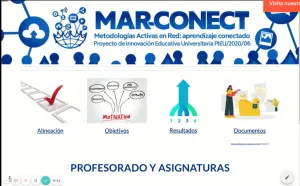

Durante las Jornadas de Innovación organizadas por el Vdo. Estudios, hemos compartido el proyecto de innovación que hemos desarrollado durante este curso 2020-21, intentando protocolizar una metodología docente que llevamos implementando varios cursos, integrando la conectividad y promoviendo un aprendizaje activo del estudiantado en Estadística Empresarial. Los resultados muy positivos para el estudiantado que ha sido proactivo para aprender.

En la web [MAR-CONECT](https://sites.google.com/umh.es/mar-conect/inicio) mostramos la experiencia y proporcionamos acceso a todos los recursos que hemos generado para acompañar el proceso de enseñanza-aprendizaje. La imagen y logos del proyecto los ha creado mi amigo y artista del SIPT Carlos Ramos (¡¡a mí me encantan!!). También os dejamos el vídeo de presentación que utilizamos en las jornadas (pulsa sobre la imagen para reproducirlo).

::: {.aviso-migrada}
Entrada publicada originalmente el 26/7/2021 en el blog anterior de esta web.
:::
