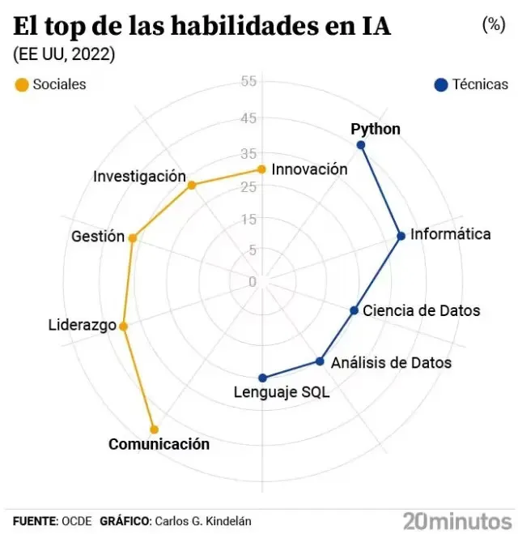

[Los empleos que piden Inteligencia Artificial crecen un 33% y la OCDE cree que se exigirá «en casi todos los trabajos» en 5 años.](https://bit.ly/48GJE6N) Desde la Universidad Miguel Hernández (UMH) hemos lanzado el programa formativo [IA4LEGOS](https://lnkd.in/ds5v7jDA). A través de cuatro cursos te damos la oportunidad de capacitarte en IA, hasta el nivel que desees, para aumentar tu empleabilidad y mejorar tus habilidades IA. Desde principios de programación en Python, recorremos los básicos en la ciencia de datos y automatización de procesos, y especializamos en Machine Learning y Deep Learning. Formación permanente certificada por la UMH, online y flexible para que puedas aprender a tu ritmo en tus horas libres, con retos prácticos para aprender programando, guiadas por profesorado comprometido con la actualización y el impacto en la formación de nuestro entorno. Como colofón, a precios públicos como no encontrarás en el mercado. Comparte y regálate IA4LEGOS. Consulta toda la información en nuestra web [https://ia4legos.umh.es](https://ia4legos.umh.es/).

::: {.aviso-migrada}
Entrada publicada originalmente el 10/1/2024 en el blog anterior de esta web.
:::
