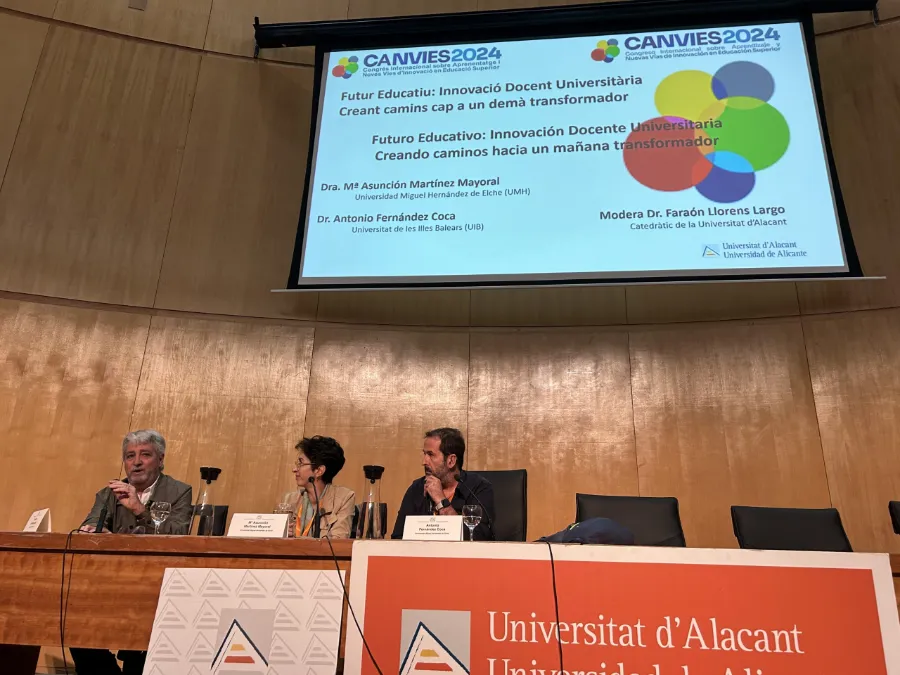

El 18 de octubre de 2024 las cinco universidades públicas valencianas, con la Universidad de Alicante como anfitriona, organizaron el primer encuentro CANVIES, el Congreso Internacional sobre Aprendizaje y Nuevas Vías de Innovación en Educación Superior. Tuve el honor de ser invitada a participar en la mesa redonda titulada «Futuro educativo: Innovación Docente Universitaria Creando caminos hacia un mañana transformador», mesa que compartí con dos compañeros sabios como Faraón Llorens (UA) y Antonio Fernández Coca (UIB). La acogida fue intensa y el interés por seguir avanzando en mejora de la docencia universitaria quedó absolutamente patente. Agradecer a la anfitriona Rosana Satorre, directora del ICE de la Universidad de Alicante, el impulso de este encuentro interuniversitario y la magnífica  organización.

::: {.aviso-migrada}
Entrada publicada originalmente el 20/10/2024 en el blog anterior de esta web.
:::
