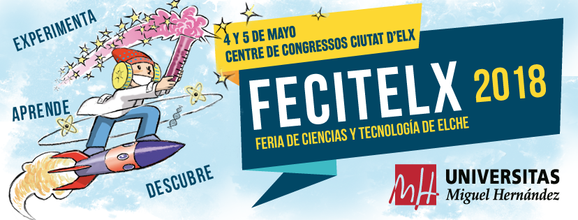
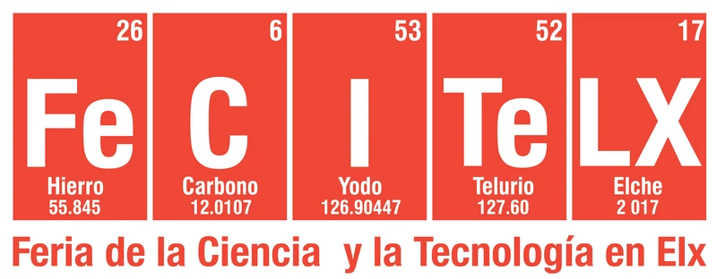
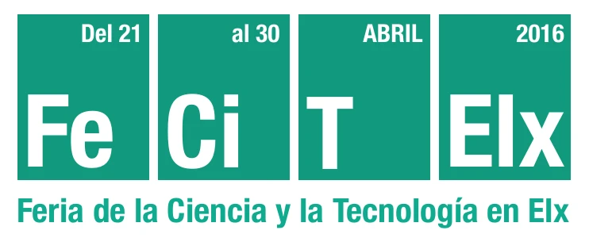

FeCiTElx es la Feria de Ciencia y Tecnología en Elche que organizó la Universidad Miguel Hernández desde el Vicerrectorado de Investigación e Innovación. Nació en 2015 para conectar a estudiantes, profesorado, profesionales y público general, compartir experiencias y proyectos de ciencia y tecnología, y motivar a escolares y universitarios hacia la formación y la divulgación científica. Coordiné sus cuatro primeras ediciones, de 2015 a 2018, desde 2017 junto a los decanatos de las facultades del Campus de Elche y la Escuela Politécnica Superior de Elche.

Cada edición reunía varias actividades alrededor de la **feria urbana** en el Centre de Congressos Ciutat d'Elx, con talleres, stands, charlas y espectáculos para todos los públicos: las Jornadas de Puertas Abiertas en los campus de la UMH y la convocatoria **Proyecta Tú**, en la que el alumnado de colegios e institutos presentaba sus propios proyectos.

Esta página agrupa la documentación que conservo de cada edición.

[FeCiTElx 2018](#fecitelx2018){.perfil}
[FeCiTElx 2017](#fecitelx2017){.perfil}
[FeCiTElx 2016](#fecitelx2016){.perfil}
[FeCiTElx 2015](#fecitelx2015){.perfil}

::: {.edicion .con-logo #fecitelx2018}
{.edicion-logo fig-alt="Cartel de FeCiTElx 2018: Experimenta, aprende, descubre. 4 y 5 de mayo, Centre de Congressos Ciutat d'Elx"}

::: {.edicion-cuerpo}
## FeCiTElx 2018 · IV edición

[4 y 5 de mayo de 2018]{.edicion-dato} [Centre de Congressos Ciutat d'Elx]{.edicion-dato} [Experimenta, aprende, descubre]{.edicion-dato}

La cuarta edición quiso aproximar ciencia, tecnología y cultura a todos los públicos, y en particular al más joven. La mañana del viernes fue para los centros educativos, con las actividades organizadas con el CEFIRE de Elche: proyectos de Primaria y Secundaria, cuentacuentos y una mesa de debate. Las tardes del viernes y el sábado, y la mañana del sábado, se abrieron los stands y talleres de la UMH y los proyectos escolares.

En el auditorio hubo espectáculos infantiles de ciencia y magia, la charla de Ciencia con Tapas del IBMC-UMH sobre las resistencias a los antibióticos, a cargo de Manuel Sánchez Angulo, y monólogos científicos. Con la convocatoria **Cuenta Alu**, estudiantes y Alumni de la UMH propusieron sus propios talleres para la feria.

**Documentos**

[Tríptico](fecitelx2018_triptico.pdf){.perfil}
[Agenda de actividades](fecitelx2018_agenda.pdf){.perfil}
[Bases de Cuenta Alu](fecitelx2018_cuenta_alu.pdf){.perfil}
[Bases del concurso de monólogos](fecitelx2018_concurso_monologos.pdf){.perfil}

En el blog: [FeCiTElx, Feria de Ciencia y Tecnología en Elche](../../blog/posts/2018-05-23-fecitelx-feria-de-ciencia-y-tecnologia-en-elche/index.qmd) · [Jornada de Puertas Abiertas en la UMH 2018](../../blog/posts/2018-03-05-jornada-de-puertas-abiertas-en-la-umh-2018/index.qmd)
:::
:::

::: {.edicion .con-logo #fecitelx2017}
{.edicion-logo fig-alt="Logotipo de FeCiTElx 2017 con casillas de tabla periódica: Fe, C, I, Te, LX"}

::: {.edicion-cuerpo}
## FeCiTElx 2017 · III edición

[19 y 20 de mayo de 2017]{.edicion-dato} [Centre de Congressos Ciutat d'Elx]{.edicion-dato} [#ExperimentaCiencia]{.edicion-dato}

La feria urbana cerró el ciclo de actividades de divulgación científica y tecnológica que la UMH desarrolló en abril y mayo en sus campus: tres jornadas de puertas abiertas, en Altea (5 de abril), Orihuela-Desamparados (10 de abril) y Elche (28 de abril), y la feria urbana FeCiTeO en Orihuela (28 de abril).

En el Centre de Congressos y en la plaza que lo rodea, con un escenario y una gran carpa científica, profesorado y estudiantes de la UMH, empresas del Parque Científico y otras entidades colaboradoras mostraron curiosidades de la ciencia y la tecnología adaptadas a todos los públicos, bajo el lema #ExperimentaCiencia: observar, tocar y experimentar. El programa se completó con magia, cuentos, charlas y monólogos científicos.

La organizaron el Vicerrectorado de Investigación e Innovación, la Facultad de Ciencias Experimentales, la Escuela Politécnica Superior de Elche y la Facultad de Ciencias Sociosanitarias de la UMH, con la colaboración del Ayuntamiento de Elche y de numerosos institutos, cátedras, asociaciones y empresas.

**Documentos**

[Díptico con el programa](fecitelx2017_diptico.pdf){.perfil}
[Cartel](fecitelx2017_cartel.png){.perfil}
[Nota de prensa](fecitelx2017_nota_prensa.pdf){.perfil}

En el blog: [Jornada de Puertas Abiertas en Elche y FeCiTElx2017](../../blog/posts/2017-05-21-jornada-de-puertas-abiertas-en-elche-y-fecitelx2017/index.qmd) · [en Informativos UMH](../../blog/posts/2017-05-19-fecitelx2017-en-informativos-umh-con-asun-martinez-y-pedro-robles/index.qmd) · [en Radio en Ruta UMH](../../blog/posts/2017-04-29-fecitelx2017-en-radio-en-ruta-umh/index.qmd)
:::
:::

::: {.edicion .con-logo #fecitelx2016}
{.edicion-logo fig-alt="Logotipo de FeCiTElx 2016 con casillas de tabla periódica: Fe, Ci, T, Elx"}

::: {.edicion-cuerpo}
## FeCiTElx 2016 · II edición

[Del 21 al 30 de abril de 2016]{.edicion-dato} [Campus de Elche y Altea · Centre de Congressos Ciutat d'Elx]{.edicion-dato}

La segunda edición se presentó como una feria de divulgación para aproximar ciencia y tecnología a la sociedad en general y al público escolar en particular: formación, divulgación y entretenimiento científico y tecnológico para todas las edades.

Repartió sus actividades en diez días: la jornada Tots fem Ciència i Tecnologia (21 y 30 de abril, Campus de Elche), las Jornadas de Puertas Abiertas en los campus de Altea (27 de abril) y Elche (28 y 29 de abril) y la feria urbana en el Centre de Congressos (29 y 30 de abril). En la feria hubo talleres y stands, exposiciones, el concurso Ciencia de Andar por Casa, monólogos de ciencia, la charla de Ciencia con Tapas y los proyectos de Proyecta Tú, hechos y contados por jóvenes científicos de Elche.

**Documentos**

[Folleto con el programa](fecitelx2016_folleto.pdf){.perfil}

En el blog: [en Radio en Ruta UMH](../../blog/posts/2016-04-29-fecitelx2016-en-radio-en-ruta-umh/index.qmd) · [en Magacín Buenos Días UMH](../../blog/posts/2016-04-21-fecitelx2016-en-magacin-buenos-dias-umh/index.qmd)
:::
:::

::: {.edicion .con-logo #fecitelx2015}
[FeCiTElx 2015 <small>I Feria de la Ciencia y la Tecnología en Elche</small>]{.edicion-sin-logo}

::: {.edicion-cuerpo}
## FeCiTElx 2015 · I edición

[Del 7 al 9 de mayo de 2015]{.edicion-dato} [Campus de Elche · Centro de Congresos Ciutat d'Elx]{.edicion-dato} [Unos 2000 asistentes]{.edicion-dato}

La primera feria se dirigió a estudiantes de niveles preuniversitarios y al público en general con tres objetivos: conectar, compartir y motivar. Las mañanas del jueves y el viernes fueron para el público escolar, con la Jornada de Puertas Abiertas de la UMH (672 estudiantes de Secundaria y 505 de Primaria, de 16 centros y 7 localidades, en 115 talleres didácticos) y la primera convocatoria de Proyecta Tú (21 proyectos de 11 centros, con 156 estudiantes).

La feria urbana, el viernes por la tarde y el sábado en el Centro de Congresos, reunió 65 talleres y stands, 25 charlas de divulgación y 5 exposiciones, con unos 2000 asistentes. Alrededor se celebraron la II Muestra de Teatro Robótico, la jornada Tots fem Ciència i Tecnologia, el concurso Ciencia de Andar por Casa y el III Certamen Científico-Tecnológico UMH. Participaron 60 profesores de la UMH como responsables de talleres y actividades y 30 estudiantes como monitores.

**Documentos**

[Memoria de resultados](fecitelx2015_memoria.pdf){.perfil}
[Presentación del proyecto](fecitelx2015_anuncio.pdf){.perfil}

En el blog: [en Programa CIO](../../blog/posts/2015-05-12-fecitelx2015-en-programa-cio/index.qmd) · [en Magacín Buenos Días UMH](../../blog/posts/2015-05-07-fecitelx2015-en-magacin-buenos-dias-umh/index.qmd) · [en InformativosUMH](../../blog/posts/2015-03-31-fecitelx2015-en-informativosumh/index.qmd)
:::
:::

[Volver a Divulgación](../index.qmd){.btn-pill .line}
