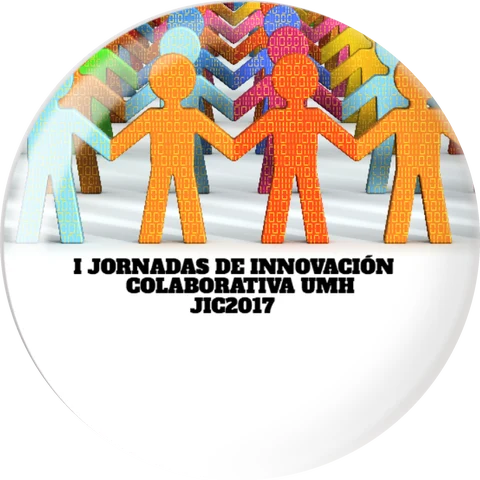
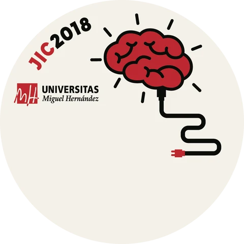

Las Jornadas de Innovación Colaborativa (JIC) reunieron en el Campus de Elche de la UMH a profesorado de Primaria, Secundaria, Formación Profesional y Universidad para contar lo que estaba probando en sus aulas y buscar con quién emprender proyectos nuevos. Las organizó el Vicerrectorado de Investigación e Innovación de la UMH, y yo me ocupé de su organización como vicerrectora adjunta de Innovación Tecnológica.

En las dos ediciones se presentaron, entre otros, los proyectos financiados por los programas de innovación de la UMH: **ÓSMOSIS**, que apoyaba a docentes no universitarios con la colaboración de profesorado y estudiantes de la UMH y el uso de sus instalaciones, y **PIEU**, para la innovación en los grados y másteres de la universidad. En cada edición se entregaron los Premios ÓSMOSIS a las mejores prácticas.

Esta página guarda la documentación de las dos ediciones para que cualquiera pueda consultar lo que se hizo allí.

::: {.edicion #jic2017}
{.edicion-chapa fig-alt="Chapa de las I Jornadas de Innovación Colaborativa UMH, JIC2017"}

::: {.edicion-cuerpo}
## JIC2017 · I Jornadas

[20 de junio de 2017]{.edicion-dato} [Edificio Arenals, Campus de Elche]{.edicion-dato} [64 comunicaciones]{.edicion-dato} [Más de 150 docentes]{.edicion-dato}

La primera edición nació con el lema «Entusiasmo, Innovación, Colaboración» y con un objetivo: compartir ideas, experiencias educativas, inquietudes y retos, y sobre todo coincidir con docentes de otros centros y niveles con quienes emprender proyectos de innovación en el futuro. En una sola jornada, de mañana y tarde, se presentaron 64 comunicaciones orales y en póster, con más de 150 docentes de todos los niveles educativos.

La ponencia invitada fue de Roser Batlle, experta en Aprendizaje-Servicio. La jornada terminó con la entrega de los tres Premios ÓSMOSIS a las mejores prácticas educativas, elegidas entre los 16 proyectos apoyados por el programa ÓSMOSIS UMH 2016-17.

Colaboraron el Vicerrectorado de Planificación, el CEFIRE de Elche, el Servicio de Innovación y Apoyo Técnico a la Docencia y a la Investigación (SIATDI) y el Máster Universitario en Formación del Profesorado de ESO, Bachillerato, FP y Enseñanza de Idiomas de la UMH.

**Documentos**

[Programa](jic2017/jic2017_programa.pdf){.perfil}
[Libro de actas](jic2017/jic2017_libro_actas.pdf){.perfil}
[Cartel](jic2017/jic2017_cartel.pdf){.perfil}
[Convocatoria](jic2017/jic2017_convocatoria.pdf){.perfil}
[Nota de prensa](jic2017/jic2017_nota_prensa.pdf){.perfil}

En el blog: [I Jornadas de Innovación Colaborativa, JIC UMH](../../blog/posts/2017-06-21-i-jornadas-de-innovacion-colaborativa-jic-umh/index.qmd).
:::
:::

::: {.edicion #jic2018}
{.edicion-chapa fig-alt="Chapa de las II Jornadas de Innovación Colaborativa UMH, JIC2018"}

::: {.edicion-cuerpo}
## JIC2018 · II Jornadas

[28 y 29 de junio de 2018]{.edicion-dato} [Edificio Arenals, Campus de Elche]{.edicion-dato} [65 comunicaciones]{.edicion-dato} [170 docentes inscritos]{.edicion-dato}

La segunda edición se repartió en dos mañanas. Su objetivo fue compartir experiencias educativas desarrolladas dentro y fuera de la UMH y en todos los niveles educativos, en particular las financiadas en las convocatorias PIEU y ÓSMOSIS, para propagar la innovación educativa y generar ideas y proyectos colaborativos entre docentes de distintos ámbitos. Se inscribieron 170 docentes de toda la provincia de Alicante y se presentaron 65 comunicaciones orales y en póster.

El viernes 29 se celebró la mesa redonda «Aprender y enseñar mejor en nuestro siglo», sobre el papel de la neurociencia, la arquitectura, las metodologías y la conectividad en las escuelas. Participaron Salvador Martínez (director del Instituto de Neurociencias), Fermín Blanco (arquitecto, CEO de Sistema Lupo y presidente de Ludantia, Arquitectura para la infancia y la juventud), Fernando Sansaloni (director del IES Cotes Baixes de Alcoy) y Amelia Granda (embajadora del Future Classroom Lab Project en la Comunidad Valenciana).

Las jornadas se cerraron con la entrega de los Premios ÓSMOSIS a la excelencia en la innovación educativa. Colaboró en la organización el Máster Universitario en Formación del Profesorado de ESO, Bachillerato, FP y Enseñanza de Idiomas de la UMH.

**Documentos**

[Programa](jic2018/jic2018_programa.pdf){.perfil}
[Libro de actas](jic2018/jic2018_libro_actas.pdf){.perfil}
[Cartel](jic2018/jic2018_cartel.pdf){.perfil}
[Nota de prensa](jic2018/jic2018_nota_prensa.pdf){.perfil}
:::
:::

[Volver a Divulgación](../index.qmd){.btn-pill .line}
