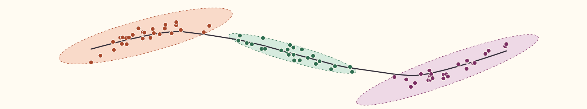

::: {.home-banner}
{fig-alt="Pantalla de cristal con paneles flotantes de estadística e IA: regresión, distribuciones, red neuronal, árbol de decisión, curva ROC, control de procesos, fórmulas, código en R y Python y un asistente que anota los gráficos"}
:::

::: {.hero}
[Hola, soy Asun Martínez Mayoral, y esta es mi web.]{.saludo}

# Estadística, ciencia de datos e IA para aprender y enseñar

[Profesora Titular de Estadística e Investigación Operativa en la Universidad Miguel Hernández de Elche. Mi sitio para compartir.]{.lead}

[Explorar recursos](recursos/index.qmd){.btn-pill .solid} [Leer el blog](blog/index.qmd){.btn-pill .line}
:::

::: {.puertas}
[[Docencia]{.kicker} [Asignaturas, cursos e innovación]{.titulo} [Grado, postgrado y formación continua, con los proyectos de innovación docente y de competencia digital.]{.texto}](docencia/index.qmd){.puerta .docencia}

[[Investigación]{.kicker} [Líneas, publicaciones y proyectos]{.titulo} [La trayectoria en una línea temporal: métodos bayesianos, medio ambiente, salud, educación e inteligencia artificial.]{.texto}](investigacion/index.qmd){.puerta .investigacion}

[[Divulgación]{.kicker} [Concursos, ferias y jornadas]{.titulo} [Va de Dades!, ferias de ciencia, jornadas, congresos de estudiantes y cursos de comunicación científica.]{.texto}](divulgacion/index.qmd){.puerta .divulgacion}
:::

::::: {.franja .blanca}
::: {.seccion-cab}
## Novedades en Recursos

[Ver el catálogo completo](recursos/index.qmd)
:::

::: {#novedades}
:::
:::::

::: {.seccion-cab style="margin-top: 3.5rem"}
## En marcha

[Docencia](docencia/index.qmd) · [Investigación](investigacion/index.qmd) · [Divulgación](divulgacion/index.qmd)
:::

::: {#proyectos-activos}
:::

::::: {.franja .ciruela}
::: {.seccion-cab}
## Del blog

[Todas las entradas](blog/index.qmd)
:::

::: {#ultimas}
:::
:::::
