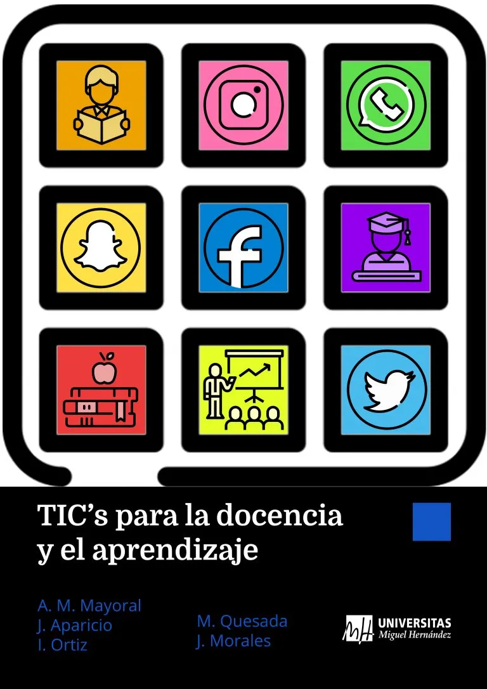
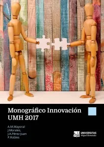

## Investigación

Mi producción científica está actualizada en estos perfiles:

[Google Scholar](https://scholar.google.es/citations?user=8QU4Vp8AAAAJ&hl=es){.btn-pill .line} [ORCID](https://orcid.org/0000-0001-6944-7335){.btn-pill .line} [Scopus](https://www.scopus.com/authid/detail.uri?authorId=6602702428){.btn-pill .line} [ResearchGate](https://www.researchgate.net/profile/Asuncion-Mayoral){.btn-pill .line}

Algunos trabajos recientes comentados en el Cuaderno:

- [ODS versus confort térmico y lumínico en centros de Secundaria](../cuaderno/posts/2020-04-14-education_sciences20/index.qmd) (*Education Sciences*, 2020)
- [El confort acústico en las aulas](../cuaderno/posts/2019-07-11-el-confort-acustico-en-las-aulas/index.qmd) (*Sustainability*, 2019)
- [Violencia de género en tiempos de COVID](../cuaderno/posts/2021-05-04-publicado-el-estudio-violencia-de-genero-en-tiempos-de-covid/index.qmd) (2021)

## Libros y materiales docentes

:::: {.tarjetas}

::: {.tarjeta}
[Libro · 2022]{.pie}

### Lean Seis Sigma para la Mejora de Procesos

A. M. Mayoral y J. Morales. Editorial electrónica UMH. ISBN 978-84-18177-14-9.

[Descargar PDF](https://innovacionumh.es/editorial/Lean%20Seis%20Sigma%20para%20la%20mejora%20de%20procesos.pdf) · [Google Play](https://play.google.com/store/books/details?id=jKVYEAAAQBAJ) · [Web asociada](https://bookdown.org/asun_mayoral/book-l6s/)
:::

::: {.tarjeta}
{width=110 fig-alt="Portada de TICs para la docencia y el aprendizaje"}

[Libro · 2019]{.pie}

### TICs para la docencia y el aprendizaje

Mª A. Martínez Mayoral, J. Morales, J. Aparicio, L. Ortiz y M. Quesada. Editorial electrónica UMH. ISBN 978-84-16024-82-7.

[Descargar PDF](http://innovacionumh.es/editorial/TICS.pdf) · [Google Play](https://play.google.com/store/books/details?id=2EvEDwAAQBAJ)
:::

::: {.tarjeta}
{width=110 fig-alt="Portada del Monográfico Innovación UMH 2017"}

[Edición · 2018]{.pie}

### Monográfico Innovación UMH 2017

Eds.: A. M. Mayoral, J. Morales, J. A. Pérez-Juan y P. Robles. Editorial electrónica UMH. ISBN 978-84-16024-55-1.

[Editorial UMH](http://editorial.umh.es/2018/11/06/monografico-innovacion-umh-2017/) · [Google Play](https://play.google.com/store/books/details?id=lm12DwAAQBAJ) · [Apple Books](https://itunes.apple.com/us/book/id1446396929)
:::

::: {.tarjeta}
[Apuntes · 2007]{.pie}

### Apuntes de Teoría de Colas

Simulación y análisis de sistemas de espera. A. M. Mayoral, J. Morales, X. Barber y J. Aparicio. Universidad Miguel Hernández. ISBN 978-84-96297-76-0.

[Descargar PDF](https://www.dropbox.com/s/4jkbpjfvp1m762y/A4%20Apuntes%20de%20Teor%C3%ADa%20de%20Colas.pdf)
:::

::: {.tarjeta}
[Apuntes]{.pie}

### Modelos estadísticos para pérdidas y reclamaciones

A. M. Mayoral, J. Morales, X. Barber y J. Aparicio. Universidad Miguel Hernández. ISBN 978-84-96297-78-4.

[Descargar PDF](https://www.dropbox.com/s/nhjrlamuo8kcasd/A4%20Mod%20Estad%20p%20P%C3%A9rd%20y%20Reclamac.pdf)
:::

::: {.tarjeta}
[Apuntes]{.pie}

### Modelos Lineales Generalizados

A. M. Mayoral y J. Morales. Universidad Miguel Hernández. ISBN 84-95893-01-0.

[Descargar PDF](https://www.dropbox.com/s/bcjt5ms5idtun2p/Modelos%20Lineales%20Generalizados.pdf)
:::

::: {.tarjeta}
[Apuntes · 2001]{.pie}

### TIS: Técnicas de Investigación Social

M. Landete y A. M. Mayoral. Universidad Miguel Hernández. ISBN 84-95315-90-4.

[Descargar PDF](https://www.dropbox.com/s/wcwdu4qw83rulr6/TIS%20a4.pdf)
:::

::: {.tarjeta}
[Prácticas · 2000]{.pie}

### Pràctiques d'Estadística Matemàtica

J. J. Abellán, R. Álvarez-Valdés, S. Aniceto, C. Armero, J. J. Bayarri, A. M. Mayoral, J. Morales, E. Mota, M. T. Rabena y S. Sanmatías. Universitat de València.
:::

::::
