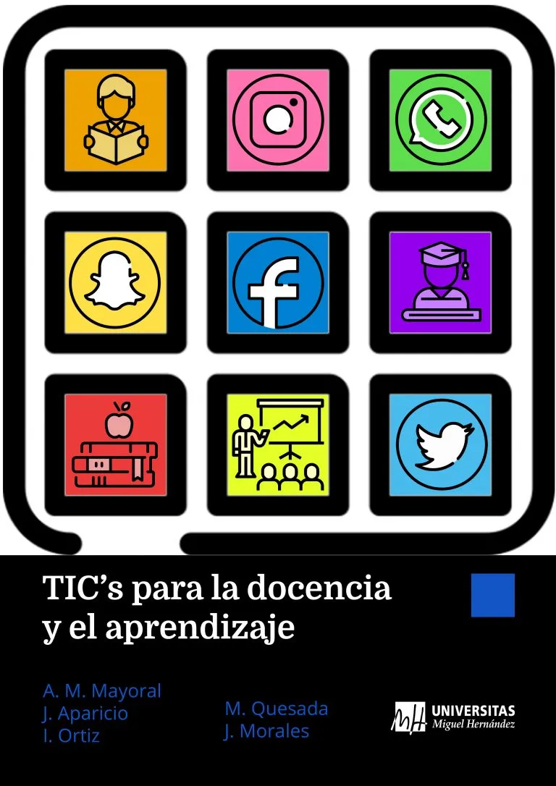

::: {.curso-pag}

[Máster Universitario en Formación del Profesorado de ESO, Bachillerato, FP y Enseñanza de Idiomas, UMH · curso 2019-20 · 4,5 ECTS, ocho sesiones presenciales de 3 horas · coordinación de la asignatura]{.curso-meta}

::: {.mod-rec .bayes-materiales}
[Guía docente 2019-20 (PDF)](/files/cursos/tics-masterprof-2019/guia-docente-2019-20.pdf){.rec} [El libro (Editorial UMH)](https://editorial.umh.es/2019/12/16/tics-para-la-docencia-y-el-aprendizaje/){.rec} [Libro en PDF](/files/libros/tics-docencia-aprendizaje.pdf){.rec .rec-sec}
:::

## En qué consistió

La asignatura preparaba al futuro profesorado de Secundaria para enseñar con tecnologías de la información y la comunicación: buscar e investigar en internet, y crear, adaptar e incorporar recursos y buenas prácticas con tecnología en el aula. Los contenidos se organizaban según las cinco áreas del Marco Común de Competencia Digital Docente del INTEF (2017): información y alfabetización informacional, comunicación y colaboración, creación de contenidos digitales, seguridad y resolución de problemas.

Las sesiones eran sobre todo prácticas: una breve revisión del tema y, después, trabajo en grupos cooperativos multidisciplinares. Una semana antes de cada sesión se publicaban las diapositivas y unos apuntes desarrollados del tema, con enlaces a tutoriales, videotutoriales y ejemplos de uso en el aula. Al empezar y al terminar el curso, el alumnado podía evaluar su competencia digital docente con un cuestionario que formaba parte de nuestra investigación sobre la capacitación digital del futuro profesorado.

La evaluación continua suponía el 65 % de la nota. Su pieza central era un **entorno personal de aprendizaje (PLE)** en forma de blog, construido en torno a una actividad didáctica de la especialidad de cada estudiante: redes sociales, sitio web, recursos TIC específicos, presentación de la actividad, vídeo y evaluación. Se completaba con una actividad interdisciplinar cooperativa compartida con otras asignaturas del máster, la formación de iniciación a la investigación educativa y un curso en línea de iniciación a LliureX. El 25 % restante era un examen tipo test.

## Temas

Ocho temas en tres bloques, uno por sesión presencial.

```{=html}
<ol class="sesiones">
<li><span class="ses-num">T1</span><span class="ses-tit"><strong>Recursos de comunicación</strong> <span class="ses-fecha">Comunicación e información</span></span><span class="ses-rec"><a class="rec" href="/files/cursos/tics-masterprof-2019/tema-1-recursos-de-comunicacion.pdf">Diapositivas (PDF)</a></span></li>
<li><span class="ses-num">T2</span><span class="ses-tit"><strong>Ofimática y colaboración online</strong> <span class="ses-fecha">Comunicación e información · presentaciones y mapas conceptuales</span></span><span class="ses-rec"><a class="rec" href="/files/cursos/tics-masterprof-2019/tema-2-ofimatica-y-colaboracion-online.pdf">Diapositivas (PDF)</a></span></li>
<li><span class="ses-num">T3</span><span class="ses-tit"><strong>Redes sociales y acceso a la información</strong> <span class="ses-fecha">Comunicación e información</span></span><span class="ses-rec"><a class="rec" href="/files/cursos/tics-masterprof-2019/tema-3-redes-sociales-y-acceso-a-la-informacion.pdf">Diapositivas (PDF)</a></span></li>
<li><span class="ses-num">T4</span><span class="ses-tit"><strong>Blogs y WebQuests</strong> <span class="ses-fecha">Recursos y creación de contenidos</span></span><span class="ses-rec"><a class="rec" href="/files/cursos/tics-masterprof-2019/tema-4-blogs-y-webquests.pdf">Diapositivas (PDF)</a></span></li>
<li><span class="ses-num">T5</span><span class="ses-tit"><strong>Objetos de aprendizaje y licenciamientos</strong> <span class="ses-fecha">Recursos y creación de contenidos</span></span><span class="ses-rec"><a class="rec" href="/files/cursos/tics-masterprof-2019/tema-5-objetos-de-aprendizaje-y-licenciamientos.pdf">Diapositivas (PDF)</a></span></li>
<li><span class="ses-num">T6</span><span class="ses-tit"><strong>Recursos TIC. Aprendizaje móvil. Gamificación</strong> <span class="ses-fecha">Recursos y creación de contenidos</span></span><span class="ses-rec"><a class="rec" href="/files/cursos/tics-masterprof-2019/tema-6-recursos-tic-aprendizaje-movil-gamificacion.pdf">Diapositivas (PDF)</a></span></li>
<li><span class="ses-num">T7</span><span class="ses-tit"><strong>Imagen, sonido y audiovisuales</strong> <span class="ses-fecha">Recursos y creación de contenidos</span></span><span class="ses-rec"><a class="rec" href="/files/cursos/tics-masterprof-2019/tema-7-imagen-sonido-y-audiovisuales.pdf">Diapositivas (PDF)</a></span></li>
<li><span class="ses-num">T8</span><span class="ses-tit"><strong>Recursos de seguimiento y evaluación del aprendizaje</strong> <span class="ses-fecha">Evaluación</span></span><span class="ses-rec"><a class="rec" href="/files/cursos/tics-masterprof-2019/tema-8-seguimiento-y-evaluacion-del-aprendizaje.pdf">Diapositivas (PDF)</a></span></li>
</ol>
```

Las diapositivas son obra del equipo docente de la asignatura (J. Aparicio, F. Borrás, F. Botella, J. R. Fernández, V. González, J. J. López-Espín, A. M. Mayoral, J. Morales, L. Ortiz, A. Peñalver, M. Quesada y D. Turienzo) y tienen licencia Creative Commons Reconocimiento-NoComercial-CompartirIgual 4.0.

## El libro

{.float-end .ms-3 .mb-2 width="130" fig-alt="Portada del libro TICs para la docencia y el aprendizaje"}

A raíz de la asignatura escribimos el libro **TICs para la docencia y el aprendizaje** (Mª A. Martínez Mayoral, J. Morales, J. Aparicio, L. Ortiz y M. Quesada; Editorial electrónica UMH, diciembre de 2019).

[Editorial UMH](https://editorial.umh.es/2019/12/16/tics-para-la-docencia-y-el-aprendizaje/) · [Copia en PDF](/files/libros/tics-docencia-aprendizaje.pdf) · [Google Play](https://play.google.com/store/books/details?id=2EvEDwAAQBAJ)

## Vídeos de cursos anteriores

- [Lista de vídeos del curso 2014-15](https://www.youtube.com/playlist?list=PLClKgnzRFYe5hwY17dxjRB_pJAeG4SqUF)
- [Lista de vídeos del curso 2013-14](https://www.youtube.com/playlist?list=PLClKgnzRFYe6fKYcWfMMrwvfFjcH61jPz)

:::

[← Volver a Recursos](../index.qmd)
